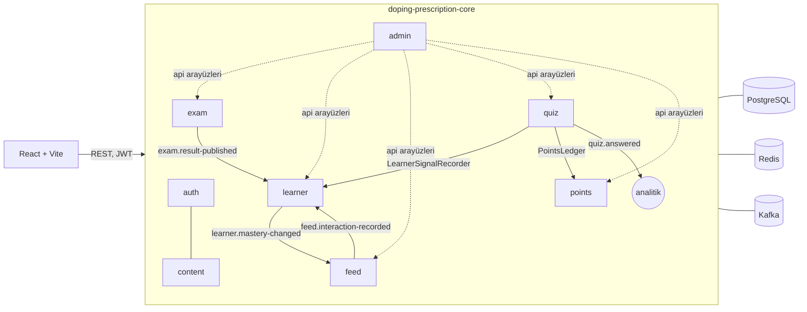

# Doping Prescription

Doping Hafıza için bir sunum demosu: öğrenci denemesini her zamanki gibi çözer, sistem sonuçtan konu bazlı eksikleri kendisi çıkarır ve Dopingle video akışını bu eksiklere göre "reçete" olarak kurar. Video sonrası mikro-soru, puan ve konu ustalık skoru (Gelişimim) döngüyü tamamlar. Hedef senaryo: [docs/demo-senaryosu.md](docs/demo-senaryosu.md).

## Gereksinimler

- Java 21 (Maven kurmaya gerek yok; `./mvnw` wrapper'ı kullanılır)
- Node.js 24 LTS (npm ile)
- Docker (Docker Desktop veya eşdeğeri; Compose ve Testcontainers için)

## Kurulum

Repo kökünden, her uygulama ayrı bir terminalde:

```bash
docker compose up -d
```

```bash
cd doping-prescription-core && ./mvnw spring-boot:run -Dspring-boot.run.profiles=demo
```

```bash
cd doping-prescription-ui && npm ci && npm run dev
```

Windows PowerShell'de `-D` argümanı tırnak içinde verilmelidir: `.\mvnw.cmd spring-boot:run '-Dspring-boot.run.profiles=demo'`.

| Adres | İçerik |
| --- | --- |
| http://localhost:5173 | Web uygulaması (öğrenci seçimi; küçük "Admin" bağlantısı demo kontrolü) |
| http://localhost:8080/swagger-ui.html | OpenAPI arayüzü (admin token'ıyla `GET /api/admin/feed-debug?slug=deniz`) |
| http://localhost:8080/actuator/health | Sağlık durumu; postgres, redis ve kafka ayrıntıları yalnızca ADMIN'e görünür |
| http://localhost:8090 | Kafka UI (isteğe bağlı: `docker compose --profile tools up -d`) |

## Demoyu oynatmak

1. http://localhost:5173 → **Admin** → Deniz kartında **Sıfırla**, sonra `SCRIPTED_IN_PROGRESS` ile **Persona yükle**. Sunum cevap anahtarı ve video etkinliği aynı sayfada.
2. Avatar → **Çıkış Yap** → **Deniz**. Ana Sayfa'daki pembe şimşek Dopingle'ı açar (genel akış).
3. **Testler ve Denemeler** → Mini Deneme 1 (cevaplar işaretli) → **Sınavı Bitir** → sonuç ekranındaki bantta **Reçeteni gör**.
4. İlk kart Olasılık ("Son denemende Olasılık: 3 soruda 0 doğru"); video bitince mikro-soru açılır, doğru cevap **+15 puan** ve "%17 → %27".
5. Sol menüden **Gelişimim**: Olasılık kırmızı ve yukarı oklu.

## Mimari

Tek dağıtılabilir birim, Spring Modulith ile sınırları testle doğrulanan modüller ([ADR 0001](docs/adr/0001-moduler-monolit.md)). Ayrıntı: [docs/mimari.md](docs/mimari.md).



| Modül | Sorumluluk |
| --- | --- |
| `auth` | Demo giriş, JWT, kullanıcılar |
| `content` | Konular, videolar, kural tabanlı etiketleme, mikro-sorular |
| `exam` | Mini denemeler, çözme, sonuç; `exam.result-published` |
| `learner` | Sinyaller, ustalık skoru (decay, bant, trend), profil önbelleği; `learner.mastery-changed` |
| `feed` | Aday havuzları, sıralama, çeşitlilik kuralları, Redis kuyruğu, fallback, etkileşimler |
| `quiz` | Mikro-soru token'ı, sunucuda cevap kontrolü; `quiz.answered` |
| `points` | Puan defteri, seri, günlük sınır |
| `admin` | Demo sıfırlama, persona, cevap anahtarı, akış debug, video etkinliği |
| `shared` | Hata modeli, event zarfı, idempotency, saat, Kafka altyapısı |

## Event akışı

Event'ler iş transaction'ı içinde outbox'a (Spring Modulith event publication registry) yazılır, commit sonrası Kafka'ya gider; anahtar `userId` ([ADR 0002](docs/adr/0002-kafka-ve-outbox.md)). Tüketiciler `processed_event` ile idempotenttir; 3 başarısız denemeden sonra mesaj `<topic>-dlt`'ye gider.

| Topic | Yayınlayan | Dinleyen |
| --- | --- | --- |
| `exam.result-published` | exam | learner (ustalık güncellemesi) |
| `learner.mastery-changed` | learner | feed (kuyruğu yeniden kur) |
| `feed.interaction-recorded` | feed | learner (`last_served_at`) |
| `quiz.answered` | quiz | — (analitik) |

Mikro-soru cevabı kullanıcıya anında "%17 → %27" ve "+15 puan" göstermesi gerektiği için senkrondur (`LearnerSignalRecorder`, `PointsLedger`).

## Test ve kalite komutları

| Komut | Nerede | Ne yapar |
| --- | --- | --- |
| `./mvnw verify` | `doping-prescription-core` | Birim + Testcontainers entegrasyon testleri, Spotless, Checkstyle, SpotBugs, JaCoCo (%80), Spring Modulith ve ArchUnit kuralları |
| `./mvnw spotless:apply` | `doping-prescription-core` | Java kodunu biçimlendirir |
| `npm run check` | `doping-prescription-ui` | `tsc`, ESLint (0 uyarı), Prettier kontrolü, Vitest |
| `npm test` | `e2e` | Playwright ile demo senaryosunun ana yolu; çalışan backend ve web uygulamasını kullanır, yoksa kendisi başlatır (önce `./mvnw -DskipTests package`). `E2E_API_PORT` / `E2E_WEB_PORT` ile başka portlarda çalışır |

CI (GitHub Actions) üç job çalıştırır: `core`, `ui` ve `e2e`.

## ADR'ler

| No | Karar |
| --- | --- |
| [0001](docs/adr/0001-moduler-monolit.md) | Modüler monolit (Spring Modulith) |
| [0002](docs/adr/0002-kafka-ve-outbox.md) | Kafka ve transactional outbox |
| [0003](docs/adr/0003-aciklanabilir-kural-tabanli-algoritma.md) | Açıklanabilir, kural tabanlı öneri algoritması |
| [0004](docs/adr/0004-openapi-sozlesmesi.md) | OpenAPI ile backend–frontend sözleşmesi |
| [0005](docs/adr/0005-modul-sinirlari-netlestirme.md) | Modül sınırlarının netleştirilmesi |
| [0006](docs/adr/0006-doping-gorsel-varliklari.md) | Doping Hafıza'nın kendi görsel varlıklarının kullanılması |

## Bilinen sınırlamalar

- Videolar simüle oynatıcıyla oynatılır; gerçek video dosyası yoktur.
- Seed soruları editör kontrolünden geçmemiştir; hesapları testle doğrulanır.
- Etki paneli, karşılaştırma ekranı, Puanlarım, Mert ve Selin persona'ları ertelendi ([docs/backlog.md](docs/backlog.md)).
- Video kalite skoru seed'den gelen statik değerdir; video etkinliği yalnızca admin'de raporlanır.

## Üretime geçerken yapılacaklar

- Gerçek kimlik doğrulama (SSO) ve gizli anahtarların bir secret store'dan okunması.
- Kafka ve PostgreSQL için replikasyon, `feed_interaction` için zaman bazlı partition.
- Video etkinliğinin (yeterli cevapla) `quality_score`'u beslemesi; ağırlıkların A/B testiyle ayarlanması.
- Gözlemlenebilirlik: metrik panoları, event gecikmesi ve DLT alarmları.
- İçerik ekibi için etiket onay ekranı ve anahtar kelime yönetimi.

## Dokümanlar

- [AGENTS.md](AGENTS.md): proje brief'i ve aşama planı
- [docs/mimari.md](docs/mimari.md), [docs/api.md](docs/api.md), [docs/algoritma.md](docs/algoritma.md), [docs/arayuz.md](docs/arayuz.md)
- [docs/ilerleme.md](docs/ilerleme.md): aşama notları
