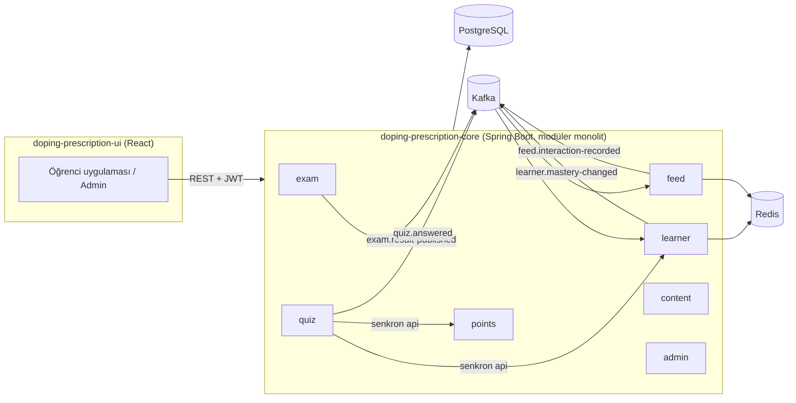

# Mimari

Sistem, Spring Modulith ile sınırları zorlanan bir **modüler monolit**tir. Modüller arası asenkron iletişim Kafka üzerinden domain event'leriyle, transactional outbox garantisiyle yapılır. Bu kararların gerekçeleri `docs/adr/` altındadır.



## 1. Modüller

Kök paket: `com.doping.prescription`. Her modül bu kökün altında bir pakettir.

| Modül | Sorumluluk | Sahip olduğu tablolar | Yayınladığı event | Dinlediği event | Public API (`api` paketi) |
| --- | --- | --- | --- | --- | --- |
| `auth` | Demo giriş, JWT, kullanıcı | users | — | — | `CurrentUser`, `UserDirectory` |
| `content` | Konular, videolar, etiketleme, mikro-sorular | topic, topic_keyword, content_item, content_topic_map, micro_question | `ContentCreated` (modül içi) | `ContentCreated` | `ContentCatalog`, `TopicCatalog`, `MicroQuestionCatalog` |
| `exam` | Denemeler, çözme, sonuç | exam, exam_question, exam_attempt, exam_answer | `ExamResultPublished` | — | `ExamSubmission` (persona için) |
| `learner` | Sinyaller, ustalık skoru, profil | learner_signal, learner_topic_mastery | `MasteryChanged` | `ExamResultPublished`, `InteractionRecorded` | `LearnerProfileQuery`, `LearnerSignalRecorder` |
| `feed` | Aday üretimi, sıralama, kuyruk, etkileşimler | feed_impression, feed_interaction | `InteractionRecorded` | `MasteryChanged` | `ImpressionQuery`, `FeedPreview` (admin), `FeedRanker` (simülasyon) |
| `quiz` | Mikro-soru token'ı, cevap kontrolü | micro_quiz_attempt | `QuizAnswered` | — | — |
| `points` | Puan defteri, seri | points_ledger, points_streak | — | — | `PointsLedger` |
| `admin` | Demo kontrolü, debug, içerik yönetimi ekranlarının API'si | — | — | — | — |
| `simulation` | Etki paneli simülasyonu | — | — | — | — |
| `shared` | Ortak altyapı: hata modeli, event zarfı, saat, idempotency. **Açık (OPEN) modül**, iş mantığı içermez | processed_event | — | — | `UserDataEraser`, `DomainEvent` |

Kurallar:

- Bir modül başka bir modülün yalnızca `api` paketindeki tiplerini ve event'lerini kullanır. Repository, entity, iç servis kullanımı yasaktır. `ModularityTests` içinde `ApplicationModules.of(PrescriptionApplication.class).verify()` bunu zorlar; ayrıca Spring Modulith dokümantasyon üreticisiyle `docs/moduller/` altına modül diyagramı üretilir.
- Döngüsel modül bağımlılığı yoktur. Örneğin `quiz` → `points` bağımlılığı tek yönlüdür: seri `points` içinde tutulur, `points` hiçbir zaman `quiz` verisini okumaz.
- `shared`, `@ApplicationModule(type = OPEN)` ile işaretlidir: hata modeli (`shared.error`), event zarfı, idempotency ve saat altyapısını tüm modüller `api` paketi dışından da kullanabilir. Bu ayrıcalık yalnızca bu dört alan için geçerlidir; `shared` içine iş mantığı girmez.
- Modüller arası veritabanı foreign key'i yoktur; başka modüle ait id'ler indeksli, FK'siz kolonlardır.
- Gerekçeler: `docs/adr/0005-modul-sinirlari-netlestirme.md`.
- `admin` demo sıfırlamayı her modülün uyguladığı `shared.api.UserDataEraser` arayüzü üzerinden yapar (her modül kendi tablolarını siler); kendisi hiçbir tabloya doğrudan yazmaz.

## 2. Paket yapısı (modül içi)

Örnek: `learner` modülü.

```
com.doping.prescription.learner
├── api/                     Diğer modüllerin kullanabileceği arayüzler, DTO record'ları, event'ler
│   ├── LearnerProfileQuery.java
│   ├── LearnerSignalRecorder.java
│   ├── MasteryChanged.java
│   └── TopicMasteryView.java
├── domain/                  Saf Java; Spring ve JPA bağımlılığı yok
│   ├── MasteryCalculator.java
│   ├── Mastery.java         (value object, 0..1 aralığını korur)
│   └── SignalType.java
├── application/             Use case servisleri, @Transactional sınırları
│   ├── ExamResultHandler.java
│   └── MasteryService.java
├── persistence/             JPA entity'leri ve Spring Data repository'leri (package-private)
├── messaging/               Kafka listener'ları
├── cache/                   Redis adaptörü
└── web/                     REST controller'lar ve request/response DTO'ları
```

- `domain` paketindeki sınıflar `final`, değişmez (immutable) ve yalnızca JDK'ya bağımlıdır. Algoritmaların tamamı burada yaşar.
- `persistence` ve `messaging` sınıfları mümkün olduğunca package-private'tır.
- Controller'lar iş mantığı içermez: isteği doğrular, `application` servisini çağırır, sonucu MapStruct ile response DTO'ya çevirir.

## 3. Event akışı

**Yayınlama (outbox):** Application servisi, iş transaction'ı içinde `ApplicationEventPublisher.publishEvent(event)` çağırır. Spring Modulith event'i aynı transaction'da `event_publication` tablosuna yazar (outbox). `@Externalized("exam.result-published::#{userId()}")` ile işaretli event'ler commit'ten sonra Kafka'ya gönderilir; anahtar `userId`'dir, böylece bir öğrencinin event'leri sırayla işlenir. Uygulama gönderimden önce çökerse, tamamlanmamış yayınlar yeniden başlatmada tekrar denenir.

**Tüketme:** İlgili modülün `messaging` paketinde `@KafkaListener`. Her listener:

1. `processed_event` tablosunda `(consumer, eventId)` var mı bakar; varsa atlar.
2. İşi ve `processed_event` kaydını tek transaction'da yapar.
3. Hata olursa `DefaultErrorHandler` ile 3 kez üstel geri çekilmeyle (exponential backoff) yeniden dener, sonra `<topic>.DLT` topic'ine gönderir ve hatayı log'lar.

**Event zarfı:** Tüm event'ler `shared.api.DomainEvent` arayüzünü uygulayan Java record'larıdır: `eventId` (UUID), `schemaVersion`, `occurredAt`, `userId`. JSON'a serileştirilir; tip bilgisi Kafka header'ında taşınır. Payload'lar `docs/api.md` §Event'ler bölümündedir.

**Modül içi event:** `ContentCreated` yalnızca `content` modülünde kullanılır, Kafka'ya gitmez; `@ApplicationModuleListener` ile işlenir.

## 4. Senkron ve asenkron yollar

| Akış | Yol | Neden |
| --- | --- | --- |
| Deneme gönder → profil güncelle → akış kuyruğunu sil | Asenkron (Kafka) | Deneme modülü profil ve akıştan habersiz olmalı; ileride ayrı servis olabilir. Gecikme hedefi 2 sn. |
| Video izleme / geçme → `last_served_at` | Asenkron (Kafka) | Kullanıcı sonucu beklemiyor. v1'de `InteractionRecorded`'ı yalnızca learner dinler; içerik kalite skoru statiktir (seed). |
| Mikro-soru cevabı → ustalık değişimi + puan | **Senkron** (`LearnerSignalRecorder`, `PointsLedger`) | Kullanıcı sonucu aynı yanıtta görmeli ("%17 → %27", "+15 puan"). Ardından `QuizAnswered` analitik için yayınlanır; learner bu event'i **dinlemez** (sinyal zaten senkron yazıldı, çift sayım olmaz). |
| Akış isteği → profil okuma | Senkron (`LearnerProfileQuery`, Redis önbellekli) | Okuma işlemi. |

## 5. Redis

| Anahtar | İçerik | TTL |
| --- | --- | --- |
| `mastery:{userId}` | Hash: topicId → mastery, confidence, lastSignalAt | 24 saat; her yazımda yenilenir |
| `feed:queue:{userId}` | Liste: hazırlanmış kartlar (JSON) | `prescription.feed.queue-ttl` |
| `feed:session:{sessionId}` | Set: oturumda gösterilen içerik id'leri (kuyruk yeniden kurulurken hariç tutulur) | 30 dk |
| `feed:session:{sessionId}:skips` | Hash: konu başına oturum içi geçme sayaçları | 30 dk |
| `quiz:token-used:{jti}` | Tek kullanımlık token işareti | token ömrü |

Redis erişilemezse: profil PostgreSQL'den okunur, akış kuyruksuz (her istekte hesaplanarak) döner. Redis hiçbir zaman tek doğruluk kaynağı değildir.

## 6. Güvenlik

- Spring Security, durumsuz (stateless) JWT; `HS256`, gizli anahtar `PRESCRIPTION_JWT_SECRET` ortam değişkeninden (demo profilinde varsayılan değer, loga yazılmaz).
- Roller `STUDENT`, `ADMIN`; `/api/admin/**` yalnız `ADMIN`. Kaynak sahipliği (bir öğrencinin başka öğrencinin attempt'ine erişememesi) servis katmanında kontrol edilir ve testlenir; başkasına ait kayıt `404` döner.
- CORS yalnızca `http://localhost:5173`.
- Quiz token'ı ayrı bir imzalı JWT'dir (`jti`, kısa ömür, tek kullanımlık).

## 7. Hata modeli

- Tüm hatalar RFC 9457 `ProblemDetail` biçiminde döner; ek alan `code` (`docs/api.md` hata kodları).
- Domain hataları `shared.error.DomainException` alt sınıflarıdır ve bir `ErrorCode` enum'u taşır. Tek bir `@RestControllerAdvice` bunları HTTP yanıtına çevirir.
- Beklenmeyen hatalarda istemciye ayrıntı verilmez; log'a stack trace ve `requestId` yazılır.

## 8. Gözlemlenebilirlik

- Spring Boot Actuator: `health` (db, redis, kafka), `info`, `metrics`.
- Her istekte `X-Request-Id` (yoksa üretilir) MDC'ye konur ve log satırlarında görünür; Kafka mesajlarına header olarak taşınır.
- Log'larda kişisel veri ve `correct_key` yoktur; kullanıcı yalnızca `userId` ile anılır.

## 9. Saat

Zamana bağlı tüm kod `java.time.Clock` bean'ini kullanır; `Instant.now()` doğrudan çağrılmaz. Takvim günü gerektiren hesaplar (günlük puan sınırı gibi) `prescription.timezone` (varsayılan `Europe/Istanbul`) saat dilimini kullanır; zaman damgaları `timestamptz`/`Instant` olarak saklanır. Testler sabit saat kullanır. Persona'lar geçmiş tarihli kayıt üretmek için servislerin `Clock` parametresi alan dahili metotlarını `Clock.offset(...)` ile çağırır; global saat değiştirilmez.
