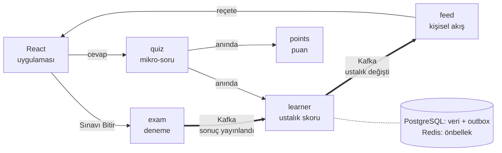
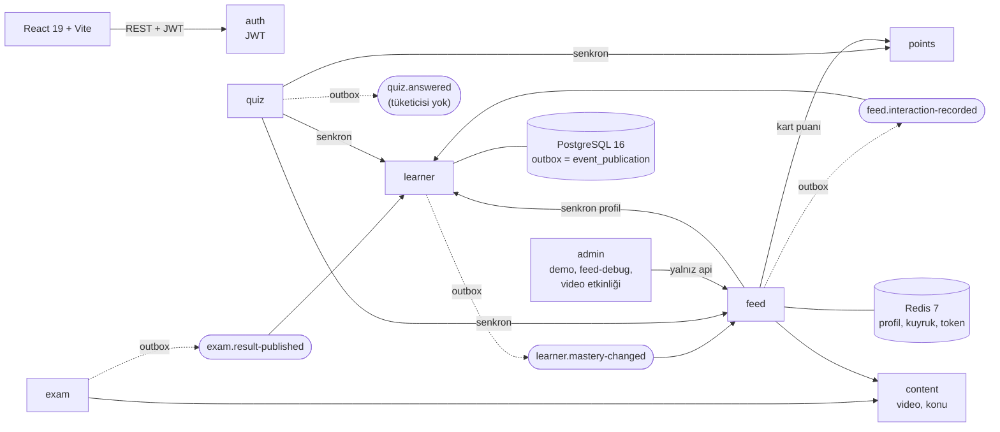
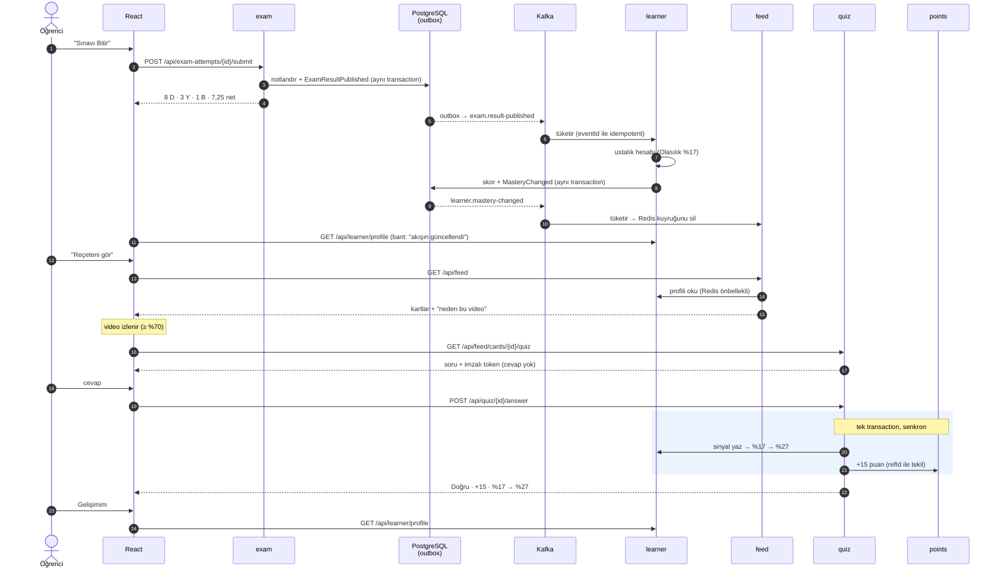
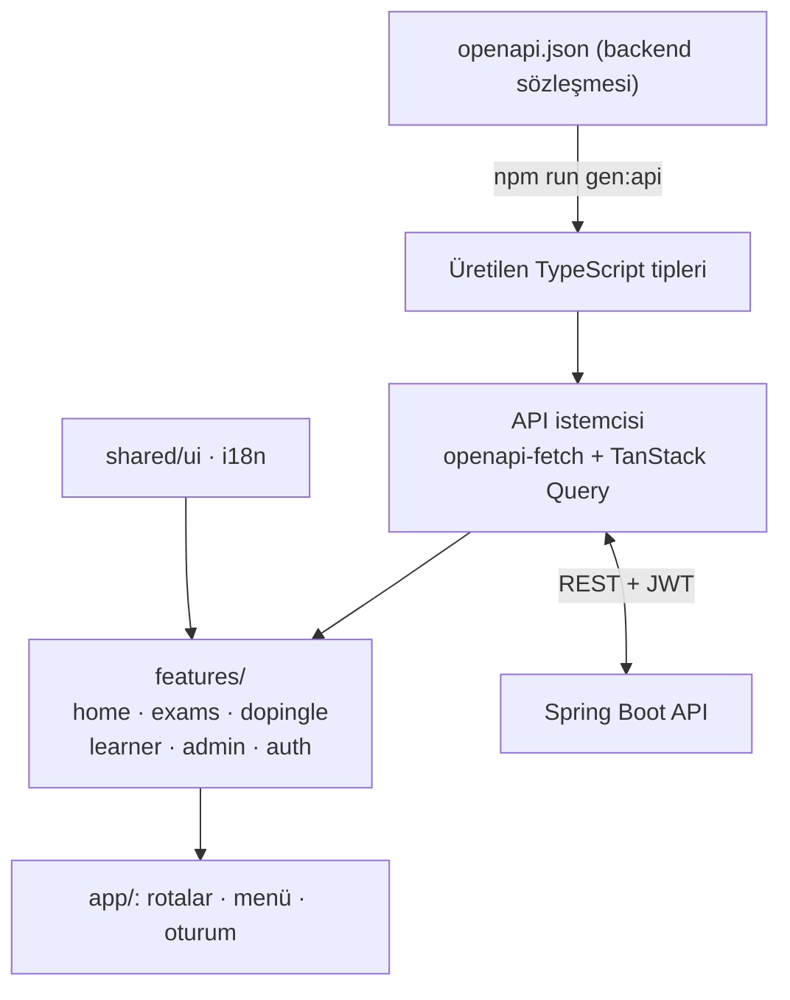
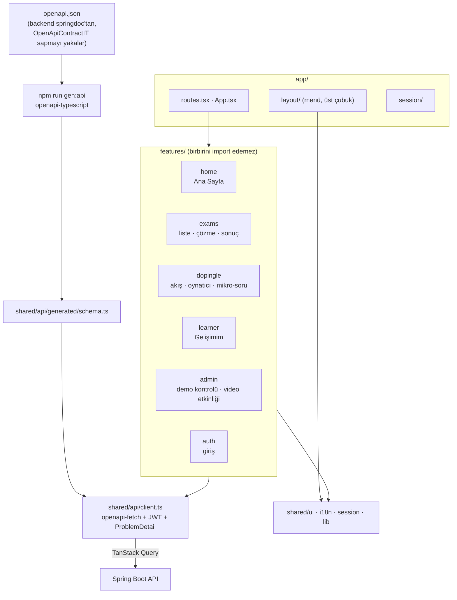

# Mimari şeması (koddan çıkarıldı)

Kaynak: çalışma ağacının 2026-10-26 hali (`main` f69b675 + commit'lenmemiş değişiklikler). Modül bağımlılıkları `*/package-info.java` içindeki `allowedDependencies`'ten, topic'ler `@Externalized` / `@KafkaListener` tanımlarından, endpoint'ler controller'lardan alındı.

PNG'ler aynı klasörde: `mimari-genel.png`, `mimari-genel-ayrintili.png`, `demo-akisi.png`, `frontend.png`, `frontend-ayrintili.png` (`.mmd` kaynaklarıyla). Yeniden üretmek için:

```bash
npx -y @mermaid-js/mermaid-cli -i docs/review/<ad>.mmd -o docs/review/<ad>.png -w 1920 -b white
```

## a) Genel mimari (sunum sürümü)



Okuma: ağır işler (deneme sonucu → profil → akış) Kafka üzerinden arka planda akar; öğrencinin anında görmesi gereken tek şey (mikro-soru sonucu) doğrudan çağrıyla. `auth`, `content`, `admin`, `shared` sunum sürümünde gizlendi.

## a') Genel mimari (ayrıntılı, yedek slayt)



Modül bağımlılıkları (`allowedDependencies`, hepsi yalnız `api` paketine):

| Modül | İzinli bağımlılıklar |
| --- | --- |
| auth, content | shared |
| exam | auth, content, shared |
| learner | auth, content, exam (event tipi), shared |
| points | auth, shared |
| feed | auth, content, learner, points, shared |
| quiz | auth, content, feed, learner, points, shared |
| admin | auth, content, exam, feed, learner, points, quiz, shared |
| simulation | yok (boş, MVP sonrası) |

Not: `learner`, `feed.interaction-recorded`'ı feed'in Java tipini import etmeden kendi kaydıyla okur (`learner/messaging/InteractionListener.java`), böylece feed → learner bağımlılığıyla döngü oluşmaz.

## b) Demo akışı (sequence diagram)



## c) Frontend yapısı (sunum sürümü)



## c') Frontend yapısı (ayrıntılı)


